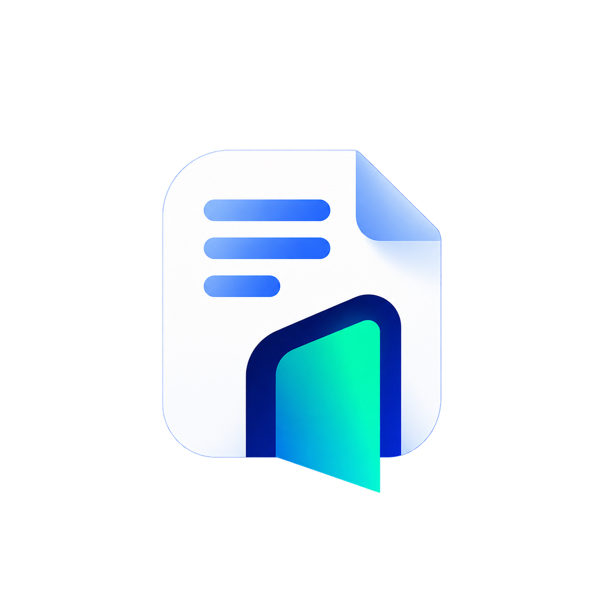

  

<h1 align="center">OpenSlip</h1>

  Professional invoices, receipts, quotations and letterheads, made on your phone in minutes. 
  Built for Nigerian small businesses and freelancers.

  <a href="https://github.com/Liberate30/openslip-releases/releases/latest/download/OpenSlip.apk"><b>⬇ Download the latest OpenSlip app</b></a>
  ·
  <a href="https://openslip.vercel.app">Website</a>

---

## What you can do

- Create invoices, receipts, quotations and letterheads with your logo and stamp
- Share them as PDF or image on WhatsApp, email or anywhere
- Numbering in your own style (for example `BP-INV-0001`)
- Keep a history of every document, even offline
- Save your customers so you never retype their details

## How to install

1. Tap **Download** above on your Android phone.
2. Open the downloaded `OpenSlip.apk`.
3. If your phone asks, allow **Install unknown apps** for your browser or file manager. This is normal for apps that aren't from the Play Store.
4. Tap **Install**, then open OpenSlip and sign up.

**Requirements:** Android 7 or newer, on a 64-bit phone (most phones from the last few years).

## Is it safe?

- Only download OpenSlip from **this page** or from **openslip.vercel.app**. Never from WhatsApp forwards or other websites.
- Every release lists its **SHA-256 checksum**. Advanced users can check that their file matches.
- Updates are signed with the same key, so a fake version can't replace the real app.

## Updating

When a new version is out, the app will tell you. Download it from this page and install it over the old one. **Don't uninstall first**, because your documents are stored on your phone.

## Need help?

Contact support from inside the app, or visit [openslip.vercel.app](https://openslip.vercel.app).

---

© 2026 OpenSlip. All rights reserved.

